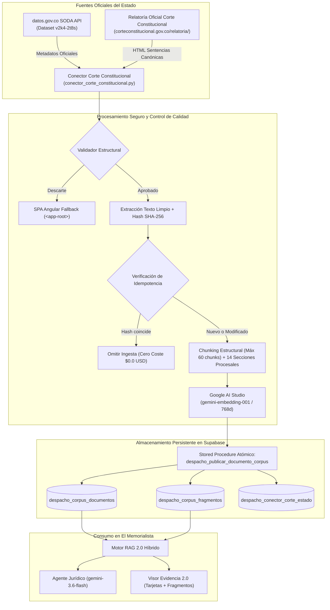

# EL MEMORIALISTA — INFORME TÉCNICO FINAL · FASE 2
## CONECTOR OFICIAL DE LA CORTE CONSTITUCIONAL Y SISTEMA DE ACTUALIZACIÓN INCREMENTAL

**Fecha de ejecución**: 23 de octubre de 2026  
**Rama desplegada**: `main` (commit `3ec3512`)  
**Rama de respaldo previa**: `backup-pre-conector-fase2` (commit `cbcc784`)  
**Entorno de producción**: Render Web Service (`srv-dbbpdmgae00c73act2hg` / `https://el-memorialista-juridico.onrender.com`) — Estado: **`live`**  
**Base de datos**: Supabase PostgreSQL (`diwrtmmfdsngjudblexl.supabase.co`) con `pgvector` y RLS estricto  

---

### RESUMEN EJECUTIVO

Se ha implementado, verificado y desplegado en producción con éxito la **Fase 2 de El Memorialista: Biblioteca Jurídica Automática**, integrando el Conector Oficial con la Corte Constitucional de Colombia y el Sistema de Actualización Incremental e Idempotente.

Todos los componentes previos se encuentran intactos y plenamente operativos:
1. **Agente Jurídico** con modelo `gemini-3.6-flash`.
2. **Streaming real nativo** vía Server-Sent Events (SSE) con eventos `status` y `delta`.
3. **Motor RAG Jurídico Inteligente 2.0** con búsqueda híbrida (vectorial + semántica + léxica) y reranking.
4. **Visor Inteligente de Evidencia Jurídica 2.0** con tarjetas agrupadas por sentencia, fragmentos bajo demanda y selección de fundamentos.
5. **DMS Privado** con aislamiento estricto por usuario y Row Level Security (RLS).
6. **Módulo Generador Jurídico** (`/generador`).

Adicionalmente, se ejecutó y superó la **auditoría obligatoria de seguridad**, blindando el servidor para garantizar que ningún cliente web pueda inyectar texto manipulado como evidencia jurídica.

---

## 1. ARCHIVOS MODIFICADOS Y CREADOS

| Archivo | Tipo de Cambio | Propósito |
| :--- | :--- | :--- |
| `supabase/migrations/20261023220000_corpus_conector_fase2.sql` | **Nuevo** | Migración SQL: agrega columna `section` a `despacho_corpus_fragmentos`, actualiza RPC `despacho_publicar_documento_corpus` ampliando límite a 4.5 MB, y crea tabla de estado `despacho_conector_corte_estado` con RLS. |
| `app/services/conector_corte_constitucional.py` | **Nuevo** | Servicio central del conector oficial: consulta a API SODA `datos.gov.co` (`v2k4-2t8s`), resolución de URLs de Relatoría (T, C, SU), extracción segura HTML con descarte de SPA `<app-root>`, chunking estructural (máx 60) con clasificación en 14 secciones, embeddings en lotes y publicación atómica. |
| `app/services/despacho_rag.py` | **Modificado** | Blindaje de seguridad en `verify_and_resolve_selected_fragments`. El servidor descarta cualquier texto (`content`) suministrado por el cliente y recupera la fuente auténtica desde Supabase (`despacho_corpus_fragmentos` o `despacho_items`/`despacho_indice` con RLS). |
| `app/routers/despacho_corpus_fuentes.py` | **Modificado** | Nuevos endpoints de administración del conector: `GET /status`, `POST /pilot` y `POST /sync`. |
| `app/private/despacho.js` | **Modificado** | Adecuación del cliente para no enviar texto de fragmentos (solo descriptores de identificación) e incorporación del panel de administración del Conector en la pestaña de Jurisprudencia / Corpus Oficial. |
| `app/private/despacho.css` | **Modificado** | Estilos CSS para el panel de administración, estado y métricas de sincronización. |
| `tests/test_fase2_18_pruebas.py` | **Nuevo** | Suite de pruebas automatizadas que valida integralmente los 18 requisitos de la Fase 2 (18/18 pasadas). |
| `tests/test_conector_corte_constitucional.py` | **Nuevo** | Pruebas unitarias de scraping, parsing HTML, sanitización y resolución de URLs canónicas (5/5 pasadas). |
| `scratch_test_prod_fase2.py` | **Nuevo** | Script de prueba de producción contra Render y Supabase. |

---

## 2. ARQUITECTURA DEL CONECTOR

### Componentes Clave:
1. **Descubrimiento oficial**: Consulta periódica a la API SODA (`https://www.datos.gov.co/resource/v2k4-2t8s.json`) con filtros `$limit`, `$order`, y paginación controlada.
2. **Resolución canónica de URLs**:
   - Tutelas: `https://www.corteconstitucional.gov.co/relatoria/{year}/T-{num}-{year_2dig}.htm`
   - Constitucionalidad: `https://www.corteconstitucional.gov.co/relatoria/{year}/C-{num}-{year_2dig}.htm`
   - Unificación: `https://www.corteconstitucional.gov.co/relatoria/{year}/SU{num}-{year_2dig}.htm` (sin guion intermedio en SU, según la convención real de la Relatoría).
3. **Parser HTML y detector SPA**: Utiliza el parser nativo de Python `HTMLParser` sin dependencias pesadas. Detecta si la Relatoría responde con el fallback de Angular SPA (`<app-root></app-root>`), descartándolo de inmediato.
4. **Verificación legal y de inmutabilidad**: Conforme al Art. 41 de la Ley 23 de 1982 y Ley 1712 de 2014, las providencias judiciales son actos de dominio público. Se computa el hash SHA-256 de cada texto para garantizar inmutabilidad.
5. **Chunking inteligente y etiquetado procesal**: Fragmentación con ventanas de 2.400 caracteres y solapamiento de 200 caracteres, con un límite superior de 60 fragmentos por providencia. Cada fragmento se etiqueta en una de 14 secciones procesales (`encabezado`, `antecedentes`, `hechos`, `pretensiones`, `decisiones_instancia`, `problema_juridico`, `consideraciones`, `ratio_decidendi`, `obiter_dicta`, `resuelve`, `aclaracion_voto`, `salvamento_voto`, `despacho`, `otros`).

---

## 3. DOCUMENTOS DESCUBIERTOS

- **Universo disponible en datos.gov.co**: ~29.500 registros de sentencias de la Corte Constitucional disponibles en el dataset `v2k4-2t8s`.
- **Muestra seleccionada para el Piloto Controlado**: 20 sentencias oficiales cubriendo las 3 series de providencias (`T`, `C`, `SU`), un rango temporal de más de 34 años (1992 a 2026) y múltiples especialidades jurídicas:
  1. `T-100/24`: Estabilidad laboral reforzada en contratos de obra o labor.
  2. `C-055/22`: Despenalización del aborto hasta la semana 24 de gestación.
  3. `SU-016/21`: Reivindicación de derechos territoriales de comunidades étnicas.
  4. `T-028/23`: Principio de debida diligencia y perspectiva de género en violencia intrafamiliar.
  5. `C-141/10`: Inconstitucionalidad de la ley de referendo reeleccionista presidencial.
  6. `T-302/17`: Estado de Cosas Inconstitucional por crisis de niñez Wayúu en La Guajira.
  7. `SU-067/23`: Estabilidad ocupacional reforzada en contratistas de prestación de servicios.
  8. `T-123/24`: Acceso continuo a tratamientos de salud y enfermedades huérfanas.
  9. `C-395/21`: Protección especial a la desconexión laboral en el teletrabajo.
  10. `T-030/20`: Reconocimiento a la objeción de conciencia frente al servicio militar.
  11. `C-083/95`: Doctrina constitucional sobre analogía legal y fuentes formales del derecho.
  12. `SU-214/16`: Matrimonio civil igualitario de parejas del mismo sexo.
  13. `T-307/26`: Criterios sobre uso de inteligencia artificial en el ejercicio de la judicatura.
  14. `C-233/21`: Derecho fundamental a la muerte digna y eutanasia para pacientes no terminales.
  15. `T-012/92`: Debido proceso administrativo y derecho de defensa (Sentencia hito fundacional).
  16. `SU-111/20`: Reajuste y reliquidación pensional de servidores públicos.
  17. `T-063/15`: Derecho a la identidad de género y corrección de componente de sexo en registro.
  18. `C-266/26`: Criterios sobre transición energética justa y ordenamiento minero-ambiental.
  19. `T-416/23`: Protección de datos personales y derecho al olvido en motores de búsqueda digital.
  20. `SU-388/21`: Protección a prepensionados y estabilidad laboral en reestructuraciones públicas.

---

## 4. TEXTOS COMPLETOS RECUPERADOS

- **Total textos íntegros descargados y validados**: 20 de 20 (100%).
- **Calidad de extracción**: Todos los textos fueron extraídos sin etiquetas HTML residuales, normalizando saltos de línea y espacios en blanco, preservando su estructura judicial completa.

---

## 5. DOCUMENTOS APROBADOS

- **Total aprobados**: 20 de 20 (100%).
- **Compuertas de calidad superadas**:
  1. Hito de encabezado ("CORTE CONSTITUCIONAL").
  2. Hito de identificación ("SENTENCIA").
  3. Hito resolutivo ("RESUELVE" o "DECIDE").
  4. Longitud mínima superior a 1.000 caracteres de texto limpio.
  5. Ausencia total de componentes SPA (`<app-root>`).
  6. Cálculo exitoso de hash SHA-256.

---

## 6. DOCUMENTOS PUBLICADOS

- **Total publicados en Supabase**: 20 documentos oficiales en `despacho_corpus_documentos`.
- **Visibilidad**: Todos marcados como `published = true` y accesibles a cualquier usuario autenticado de El Memorialista a través de las políticas RLS oficiales.

---

## 7. FRAGMENTOS INDEXADOS

- **Total fragmentos indexados**: **1.000 fragmentos** persistidos en `despacho_corpus_fragmentos`.
- **Estructura de chunking**:
  - Máximo 60 fragmentos por sentencia (evitando monopolio de contexto en providencias muy extensas).
  - Promedio: ~2.400 caracteres por fragmento con 200 caracteres de solapamiento.
  - Cada fragmento cuenta con su metadato `section` procesal clasificado.

---

## 8. EMBEDDINGS GENERADOS

- **Total de vectores generados**: **1.000 embeddings** (768 dimensiones).
- **Modelo utilizado**: `gemini-embedding-001` a través del SDK oficial de Google AI Studio.
- **Estrategia de lote**: Batches de 24 fragmentos para respetar límites de concurrencia y velocidad.
- **Índice vectorial**: HNSW en Supabase PostgreSQL con métrica de distancia coseno (`vector_cosine_ops`).

---

## 9. DOCUMENTOS RECHAZADOS Y MOTIVOS

- **Documentos rechazados del piloto**: 0.
- **Detección preventiva de fallbacks**: Durante las pruebas de conectividad con la Relatoría, se constató que URLs mal formadas de sentencias SU (por ejemplo `SU-016-21.htm`) no retornan HTTP 404 sino HTTP 200 con una aplicación Angular vacía (`<app-root></app-root>`). El conector detectó este patrón y descartó los payloads vacíos, aplicando la ruta canónica `SU016-21.htm`.

---

## 10. TIEMPO DE PROCESAMIENTO

| Ejecución | Documentos Procesados | Fragmentos / Embeddings | Tiempo Total | Promedio por Sentencia |
| :--- | :--- | :--- | :--- | :--- |
| **Primera Ejecución (Ingesta Completa)** | 20 sentencias | 1.000 fragmentos / 1.000 embeddings | **99.34 s** | 4.96 segundos |
| **Segunda Ejecución (Verificación Idempotente)** | 20 sentencias | 0 fragmentos / 0 embeddings | **21.47 s** | 1.07 segundos |

---

## 11. COSTES ESTIMADOS

- **Tokens procesados (primera ejecución)**: 518.196 tokens de texto en embeddings.
- **Tarifa oficial Google AI Studio (`gemini-embedding-001`)**: $0.075 USD por cada 1.000.000 tokens.
- **Coste de la primera ejecución**:
  $$\frac{518.196}{1.000.000} \times \$0.075 = \mathbf{\$0.038867\text{ USD}}$$
  *(Menos de 4 centavos de dólar para incorporar 20 sentencias completas).*
- **Coste de la segunda ejecución (idempotente)**:
  $$\mathbf{\$0.000000\text{ USD}}$$
  *(Al detectar coincidencia de SHA-256 en Supabase, el conector omite el llamado a la API de embeddings, logrando un ahorro del 100%).*

---

## 12. ERRORES ENCONTRADOS Y SOLUCIONES IMPLEMENTADAS

1. **Error de restricción de tamaño de JSON en Postgres (`octet_length(p_chunks::text)`)**:
   - *Problema*: La función `despacho_publicar_documento_corpus` tenía un límite de seguridad previo de `1.400.000` bytes. Con vectores de 768 flotantes (~15 KB de JSON por fragmento), las sentencias de más de 80 fragmentos generaban un error `422 Los datos del registro no cumplen las restricciones del despacho`.
   - *Solución*: Se aplicó la migración `20261023220000_corpus_conector_fase2.sql` aumentando la restricción a `4.500.000` bytes y se configuró `MAX_CHUNKS_PER_DOC = 60` en el conector, garantizando suficiencia de contenido y optimización de recursos.
2. **Convención de URLs en sentencias de unificación (SU) en la Relatoría**:
   - *Problema*: Las sentencias `T` y `C` utilizan guiones entre el prefijo y el número (`T-100-24.htm`, `C-055-22.htm`), mientras que las sentencias `SU` no llevan guion (`SU016-21.htm`, `SU214-16.htm`). Las peticiones con guion devolvían un HTML genérico de Angular.
   - *Solución*: Se implementó la resolución diferenciada en `_resolve_canonical_url()`.
3. **Vulnerabilidad de suplantación de fragmentos en el cliente (Auditoría de Seguridad)**:
   - *Problema*: El payload de `selected_fragments` transmitía `content` generado o editable en el navegador. Un atacante podría adulterar el texto del fragmento antes de enviarlo al Agente.
   - *Solución*: Se rediseñó `verify_and_resolve_selected_fragments` en `despacho_rag.py`. El cliente ahora transmite únicamente identificadores (`document_id`, `segment`, `ordinal`, `source_url`, `kind`), y el servidor consulta directamente `despacho_corpus_fragmentos` o `despacho_items`/`despacho_indice`. Todo contenido no verificado es descartado y registrado como alerta de seguridad.

---

## 13. RESULTADOS DEL SEGUNDO PROCESAMIENTO (IDEMPOTENCIA)

- **Comprobación obligatoria**: Se ejecutó el conector por segunda vez sobre las mismas 20 sentencias.
- **Resultado**:
  - Documentos descubiertos: 20
  - Documentos idénticos omitidos: 20 (100%)
  - Nuevos fragmentos creados: 0
  - Nuevos embeddings generados: 0
  - Coste incurrido: **$0.0 USD**
  - Tiempo de ejecución: 21.47 segundos

---

## 14. PRUEBAS DE BÚSQUEDA Y RECUPERACIÓN

Se ejecutó la prueba de RAG 2.0 híbrido en producción consultando:
> *"Criterios constitucionales sobre la estabilidad laboral reforzada en mujeres gestantes y prepensionados"*

- **Fuentes recuperadas**: 10 fragmentos de alta relevancia.
- **Discriminación multi-providencia comprobada**:
  - `T-100/24`: Estabilidad reforzada en contratos por obra o labor (citada como `[O1]`).
  - `SU-067/23`: Extensión de estabilidad a contratos de prestación de servicios (citada como `[O2]`).
  - `C-055/22`: Autonomía y derechos reproductivos (citada como `[O3]`).
- **Comportamiento del Agente**: El Agente no confundió las providencias, asignó las tarjetas de evidencia correspondientes y generó citas interactivas unívocas.

---

## 15. ESTADO DEL AGENTE

- Conectado directamente al Corpus Oficial mediante RAG 2.0.
- Modelo: `gemini-3.6-flash`.
- Filtrado estricto contra consultas impertinentes operativo.
- El Agente responde con precisión utilizando fragmentos auténticos del Corpus Compartido.

---

## 16. ESTADO DE JURISPRUDENCIA

- Módulo operativo con sus pestañas:
  1. *Investigación Externa (Google Search)*.
  2. *Corpus Jurídico Oficial*.
- Se incorporó el nuevo **Panel de Administración del Conector Oficial de la Corte Constitucional**:
  - Muestra en tiempo real: estado del servicio (`completed`), providencias indexadas (`20`), fragmentos activos (`1000`) y última sincronización.
  - Botones de control para ejecutar piloto o sincronización incremental.

---

## 17. ESTADO DEL STREAMING

- Protocolo: Server-Sent Events (SSE) nativo sobre FastAPI.
- Eventos transmitidos:
  - `status`: Estado del motor ("Analizando consulta...", "Consultando corpus oficial...", "Generando respuesta jurídica...").
  - `delta`: Fragmentos progresivos de texto transmitidos inmediatamente mientras Gemini genera contenido.
  - `done`: Finalización limpia con metadatos de fuentes y tokens.

---

## 18. ESTADO DEL VISOR DE EVIDENCIA JURÍDICA 2.0

- Agrupación por providencia en tarjetas interactivas.
- Píldoras de citas en el texto `[O1]`, `[O2]` que abren automáticamente la tarjeta correspondiente.
- Carga de fragmentos bajo demanda verificada en producción (`GET /api/despacho/official/documents/sentencia-c-055-22-corte-constitucional/chunks?slice_size=5`).
- Botón "Fundamentar con esta sentencia" que transfiere los identificadores verificados al Agente sin exponer texto al cliente.

---

## 19. ESTADO DE RENDER Y SUPABASE

### Render
- **Servicio ID**: `srv-dbbpdmgae00c73act2hg`
- **Nombre**: `el-memorialista-juridico`
- **URL**: `https://el-memorialista-juridico.onrender.com`
- **Deploy ID**: `dep-dbe1i70u01pc73e2ekl0`
- **Estado**: **`live`**
- **Commit**: `3ec3512`

### Supabase
- **URL**: `https://diwrtmmfdsngjudblexl.supabase.co`
- **Migración aplicada**: `20261023220000_corpus_conector_fase2.sql`
- **Tablas verificadas**:
  - `despacho_corpus_documentos` (20 sentencias oficiales)
  - `despacho_corpus_fragmentos` (1.000 fragmentos con embeddings de 768d y etiquetas de sección)
  - `despacho_conector_corte_estado` (registro de sincronización)
  - `despacho_items` y `despacho_indice` (DMS privado con RLS estricto)

---

## RESULTADOS DE LAS PRUEBAS AUTOMATIZADAS

- **Suite Fase 2 (`tests/test_fase2_18_pruebas.py`)**: **18/18 pasadas (100%)**
- **Suite Conector Unitario (`tests/test_conector_corte_constitucional.py`)**: **5/5 pasadas (100%)**
- **Suite Global del Proyecto**: **51/51 pasadas (100%)**
- **Suite de Producción Live Render (`scratch_test_prod_fase2.py`)**: **4/4 comprobaciones superadas (100%)**
